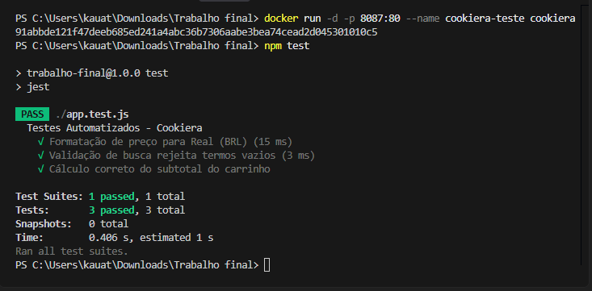
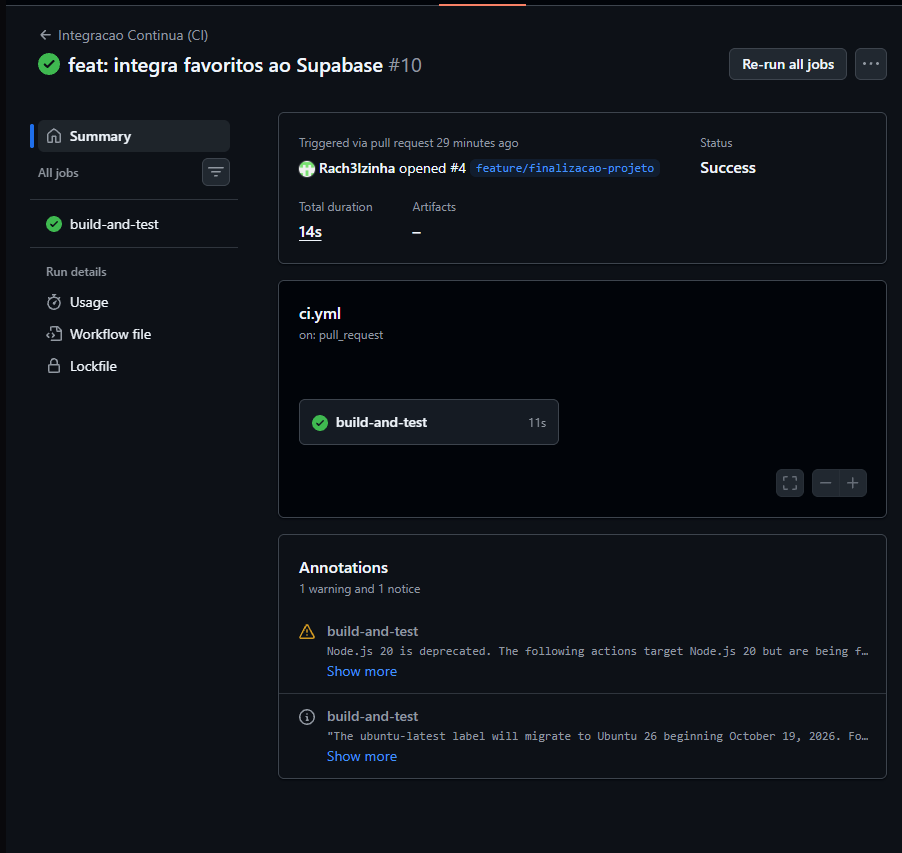
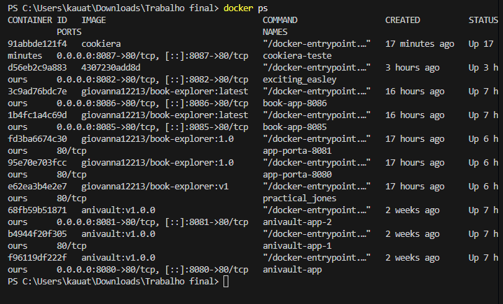
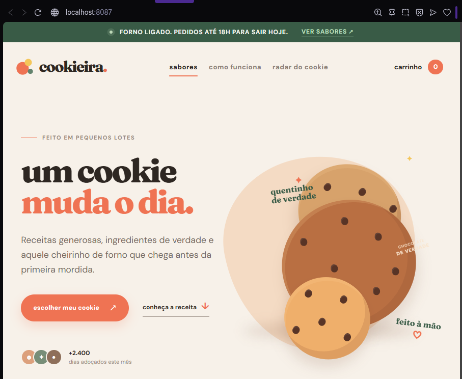
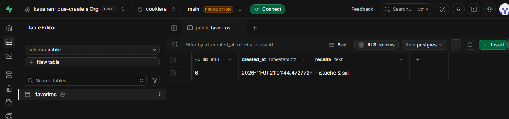

# 🍪 Cookiera — Aplicação Web de Gestão e Receitas

## 📋 Sobre o Projeto

O **Cookiera** é uma aplicação web interativa desenvolvida para consulta de receitas de cookies, gerenciamento de favoritos e carrinho de compras.

O projeto permite visualizar diferentes sabores de cookies, pesquisar informações de produtos por meio da API externa Open Food Facts e armazenar receitas favoritas utilizando o Supabase.

A aplicação foi desenvolvida como projeto final do Bootcamp, aplicando conceitos de desenvolvimento web, integração com APIs, banco de dados, testes automatizados, integração contínua e conteinerização.

## 👥 Integrantes do Grupo

| Nome Completo | Matrícula | GitHub | Função Principal |
|---|---|---|---|
| Kauã Henrique Tolentino Nunes | 22612244 | [@kauahenrique-create](https://github.com/kauahenrique-create) | Frontend, Docker e CI/CD |
| Rachel Tolentino de Sena | 22612246 | [@Rach3lzinha](https://github.com/Rach3lzinha) | Frontend e Persistência de Dados |

## 🛠️ Tecnologias Utilizadas

- **HTML5:** estrutura da aplicação.
- **CSS3:** estilização e responsividade.
- **JavaScript:** funcionalidades e interatividade.
- **Supabase:** banco de dados PostgreSQL na nuvem.
- **Open Food Facts API:** consulta de informações externas de produtos.
- **Jest:** execução dos testes automatizados.
- **Git e GitHub:** versionamento e colaboração.
- **GitHub Actions:** integração contínua.
- **Docker:** conteinerização da aplicação.
- **Nginx Alpine:** servidor dos arquivos estáticos dentro do container.

## ✨ Funcionalidades

- Visualização do catálogo de cookies.
- Pesquisa e filtragem de produtos.
- Consulta de informações por meio da API Open Food Facts.
- Adição e remoção de receitas favoritas.
- Persistência dos favoritos no Supabase.
- Carrinho de compras.
- Armazenamento do carrinho utilizando LocalStorage.

## 🗄️ Banco de Dados — Supabase

O projeto utiliza o Supabase, baseado em PostgreSQL, para armazenar os cookies favoritos.

### Tabela `favoritos`

| Campo | Tipo | Descrição |
|---|---|---|
| id | int8 | Identificador do registro |
| created_at | timestamptz | Data de criação |
| receita | text | Nome da receita favoritada |

A aplicação realiza operações de consulta, inclusão e exclusão dos favoritos no banco de dados.

A persistência permite que os favoritos continuem disponíveis após atualizar ou reabrir a página.

## 🌐 API Externa

O projeto utiliza a API pública **Open Food Facts** para consultar informações de produtos alimentícios.

Documentação: https://wiki.openfoodfacts.org/API

## 🧪 Testes Automatizados

O projeto utiliza Jest para executar testes automatizados.

Atualmente, são realizados três testes:

1. **Formatação de preço:** verifica a conversão de valores para a moeda brasileira (BRL).
2. **Validação de busca:** verifica se termos vazios ou compostos apenas por espaços são rejeitados.
3. **Cálculo do subtotal:** verifica se os valores e quantidades dos produtos são calculados corretamente.

### Como executar os testes

Instale as dependências:

```bash
npm install
```

Execute os testes:

```bash
npm test
```

**Resultado validado:** 3 testes passaram, sem falhas, na execução local.

## ⚙️ Integração Contínua — GitHub Actions

O projeto utiliza GitHub Actions para executar automaticamente os testes.

O workflow está configurado para executar em:

- Push nas branches `main` e `feature/*`.
- Pull Requests direcionados à branch `main`.

### Etapas do workflow

1. Baixar o código do repositório.
2. Configurar o Node.js 20.
3. Instalar as dependências com `npm ci`.
4. Executar os testes com `npm test`.

O workflow foi executado com sucesso, apresentando o indicador verde na aba Actions do GitHub.

## 🔀 Processo de Desenvolvimento e Colaboração

O desenvolvimento utiliza Git e GitHub para organizar o trabalho em equipe.

As práticas adotadas incluem:

- Desenvolvimento em branches separadas.
- Utilização de Pull Requests para integração de código.
- Revisão de código por outro integrante.
- Execução automática dos testes antes da integração.
- Utilização da branch `main` como versão principal do projeto.

## 🐳 Docker

A aplicação utiliza Docker com a imagem `nginx:alpine` para disponibilizar os arquivos HTML, CSS e JavaScript por meio de um servidor web.

### Imagem publicada no Docker Hub

Repositório público:

https://hub.docker.com/r/kauatolentino/cookiera

### Como executar com Docker

Construa a imagem:

```bash
docker build -t cookiera .
```

Inicie o container:

```bash
docker run -d -p 8087:80 --name cookiera-teste cookiera
```

Acesse a aplicação pelo navegador:

http://localhost:8087

### Como encerrar o container

```bash
docker stop cookiera-teste
docker rm cookiera-teste
```

## 🚀 Como Executar o Projeto Localmente

### Pré-requisitos

- Git instalado.
- Node.js e npm instalados.
- Navegador atualizado.

### Passo a passo

Clone o repositório:

```bash
git clone https://github.com/Rach3lzinha/bootcamp2-projeto-final.git
```

Entre na pasta:

```bash
cd bootcamp2-projeto-final
```

Instale as dependências:

```bash
npm install
```

Abra o arquivo `index.html` no navegador ou utilize a extensão Live Server do Visual Studio Code.

## 📸 Evidências do Desenvolvimento

### Testes Automatizados



### GitHub Actions


### Falha e Correção do CI



### Docker

 

### Supabase



## 🔀 Resolução de Conflitos de Merge

Durante o desenvolvimento do projeto, não ocorreram conflitos de merge entre as branches.

## 📦 Repositórios e Links

- **GitHub:** https://github.com/Rach3lzinha/bootcamp2-projeto-final
- **Docker Hub:** https://hub.docker.com/r/kauatolentino/cookiera
- **Open Food Facts:** https://wiki.openfoodfacts.org/API
- **Supabase:** https://supabase.com/

---

**Cookiera — Mais praticidade para quem ama cookies! 🍪**